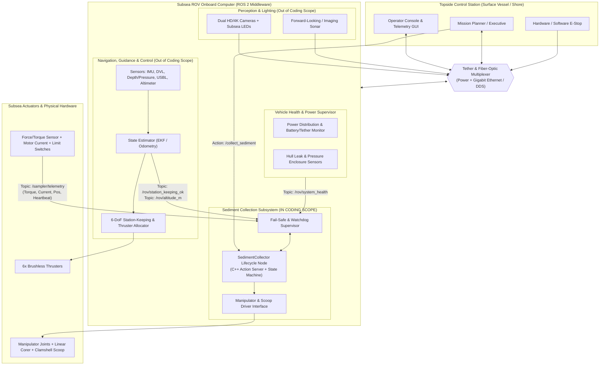
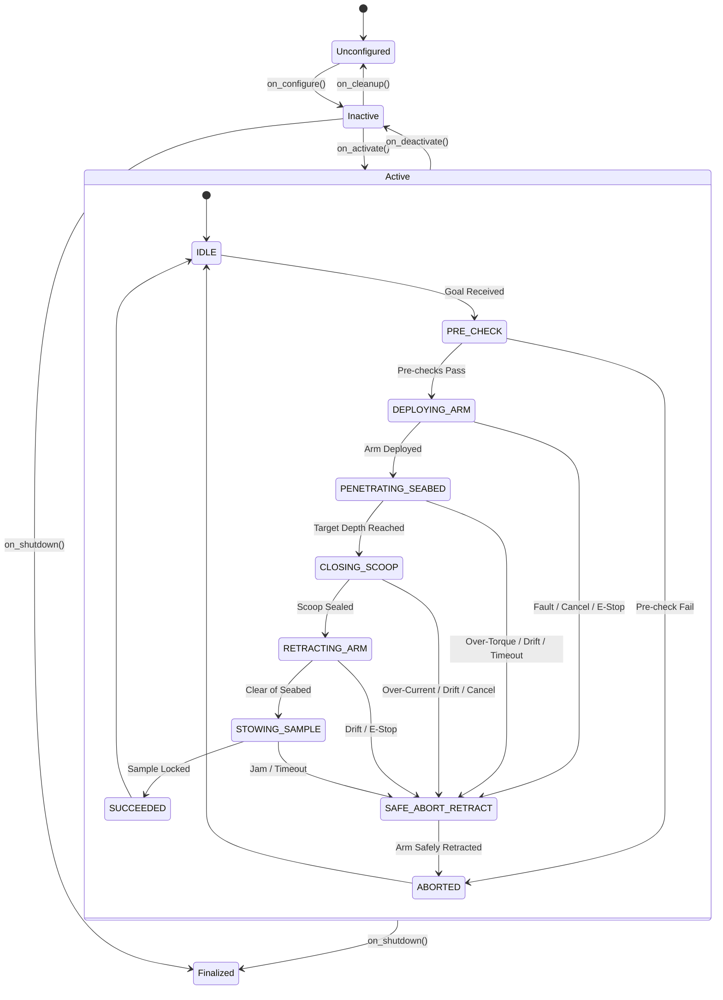

# EyeROV Seabed Sediment Collection System — Complete System Architecture

## 1. Operational Concept & Engineering Assumptions
To bridge the system-level ROV design with the focused ROS 2 C++ implementation, the following realistic vehicle and operational assumptions are established (modeled after an inspection/light-intervention ROV such as the **EyeROV TROUT**):

* **Vehicle Platform:** 300m-rated, tethered, 6-DoF vectored-thruster ROV equipped with DVL, IMU, depth/pressure sensor, altimeter, USBL, and dual HD/4K cameras with subsea LEDs.
* **Sampling Payload:** 3-DoF electrically actuated manipulator arm fitted with a linear corer and clamshell sediment scoop, axial force/torque load cell, motor current sensor, limit switches, and a sealed sample storage canister.
* **Operational Workflow:**
  1. Topside operator navigates the ROV to the target seabed site and engages **Auto-Hover / Station-Keeping** at a nominal altitude of `0.5 m` above the seabed.
  2. Topside Mission Executive dispatches a `CollectSediment` ROS 2 Action goal to the onboard `SedimentCollector` Lifecycle Node.
  3. The controller verifies environmental and vehicle safety preconditions, deploys the manipulator, penetrates the seabed, closes the scoop, retracts, and stows the sample.
  4. If any anomaly occurs (rock obstruction, ROV drift, sensor drop, or operator cancel), an explicit fail-safe sequence halts downward/closing motion and executes a safe vertical retraction.

---

## 2. Complete ROV System Block Diagram

---

## 3. Subsystem Boundaries & ROS 2 Interfaces

| Subsystem | Role in Complete ROV | Coding Scope | ROS 2 Interface Boundary |
| :--- | :--- | :--- | :--- |
| **Topside Control Station** | Pilot visualization, mission triggering, manual override, and E-Stop. | Out of scope (CLI / Launch demo) | Sends `CollectSediment` Action Goal/Cancel; triggers Lifecycle transitions. |
| **Navigation & Station-Keeping (GNC)** | Fuses DVL, IMU, Depth, and Altimeter to hold ROV stationary over seabed. | Out of scope (Simulated publisher) | Publishes `/rov/station_keeping_ok` (`std_msgs/Bool`) & `/rov/altitude_m` (`std_msgs/Float32`). |
| **Perception & Lighting** | Provides live visual feedback of seabed terrain and manipulator workspace. | Out of scope (Architecture only) | Streams video over tether; operator confirms soft-sediment landing zone. |
| **Vehicle Health & Safety** | Monitors hull leak sensors, tether link heartbeat, and power bus stability. | Out of scope (Simulated publisher) | Publishes `/rov/emergency_stop` (`std_msgs/Bool`). |
| **Sediment Collection Controller** | Manages arm deployment, penetration, scooping, retraction, stowing, and fail-safes. | **IN SCOPE (ROS 2 C++)** | Exposes `/collect_sediment` Action Server; publishes `/sampler/cmd`; subscribes `/sampler/telemetry`. |

---

## 4. Lifecycle & Execution State Machine

The controller uses `rclcpp_lifecycle::LifecycleNode` to guarantee deterministic startup, safe hardware readiness, and clean shutdown.

### Lifecycle States (Node-Level Management)
* **Unconfigured → Inactive (`on_configure`):** Loads parameters (torque limits, timeouts, altitude bounds), initializes publishers/subscribers, and creates the action server.
* **Inactive → Active (`on_activate`):** Enables action server goal acceptance, activates lifecycle publishers, and starts the 20 Hz safety watchdog timer.
* **Active → Inactive (`on_deactivate`):** Safely aborts any active collection sequence, commands actuator halt/retract, and disables goal acceptance.
* **Inactive → Unconfigured (`on_cleanup`) / Finalized (`on_shutdown`):** Releases pointers, stops timers, and cleans up resources deterministically.

### Execution States (Inside `Active` Lifecycle State)
1. **`IDLE`:** Waiting for a `CollectSediment` action goal.
2. **`PRE_CHECK`:** Verifies station-keeping is `true`, seabed altitude is within `[0.3m, 1.0m]`, vehicle health is `OK`, and sampler telemetry is fresh.
3. **`DEPLOYING_ARM`:** Extends manipulator from the stowed bay to the vertical seabed approach pose.
4. **`PENETRATING_SEABED`:** Drives the corer/scoop downward to `target_depth_cm` while continuously monitoring axial force/torque.
5. **`CLOSING_SCOOP`:** Actuates clamshell jaws / core shutter to trap the sediment sample.
6. **`RETRACTING_ARM`:** Pulls the sampler vertically out of the seabed back to a safe clearance height.
7. **`STOWING_SAMPLE`:** Docks the sampler into the sealed sample canister bay and engages the locking latch.
8. **`SUCCEEDED`:** Populates collected sample metrics in the Action Result and returns to `IDLE`.
9. **`SAFE_ABORT_RETRACT` *(Fail-Safe State)*:** Immediately halts downward/closing motion, commands an emergency vertical retraction to the stowed safe position, and reports the specific failure code.

---

## 5. Explicit Fail-Safe Matrix

All error codes below map directly to the constants defined in `eyerov_sediment_interfaces/action/CollectSediment.action` (`ERR_NONE = 0` on success):

| Fault Condition | Detection Mechanism | Immediate Fail-Safe Action | Action Result Error Code |
| :--- | :--- | :--- | :--- |
| **Pre-Check Failure** | Station-keeping `false`, altitude outside `[0.3m, 1.0m]`, stale telemetry, or E-Stop active before start | Reject transition into deployment; abort immediately from `PRE_CHECK` | `ERR_PRECHECK_FAILED (1)` |
| **Rock / Hard Obstruction** | `/sampler/telemetry` reports `torque_nm > max_torque_nm` or over-current | Immediately halt downward actuator; transition to `SAFE_ABORT_RETRACT` | `ERR_OVER_TORQUE (2)` |
| **ROV Drift / Station-Keeping Lost** | `/rov/station_keeping_ok` transitions to `false` or altitude out of `[0.2m, 1.2m]` | Halt arm motion immediately to prevent structural damage; execute `SAFE_ABORT_RETRACT` | `ERR_STATION_KEEPING_LOST (3)` |
| **Sensor / Telemetry Timeout** | 20 Hz watchdog timer detects no `/sampler/telemetry` update for `> 500 ms` | Freeze actuators; command blind safe vertical retract; abort sequence | `ERR_SENSOR_TIMEOUT (4)` |
| **Phase / Total Execution Timeout** | Elapsed phase or total goal duration exceeds configured threshold | Halt current phase; transition to `SAFE_ABORT_RETRACT` | `ERR_EXECUTION_TIMEOUT (5)` |
| **Topside Operator Cancel** | Action `handle_cancel` invoked during active sequence | Preempt active motion; execute `SAFE_ABORT_RETRACT` before returning canceled result | `ERR_USER_CANCELED (6)` |
| **Emergency Stop (E-Stop)** | `/rov/emergency_stop` becomes `true` | Immediately stop active drive; execute `SAFE_ABORT_RETRACT` | `ERR_ESTOP (7)` |
| **Lifecycle Deactivation** | `on_deactivate()` triggered while a goal is active | Signal immediate abort flag, command safe stop/retract, reject new goals | `ERR_NODE_DEACTIVATED (8)` |
| **Internal Hardware Fault** | `/sampler/telemetry` reports `hardware_fault == true` | Halt actuator command; execute `SAFE_ABORT_RETRACT` if arm is extended | `ERR_HARDWARE_FAULT (9)` |
